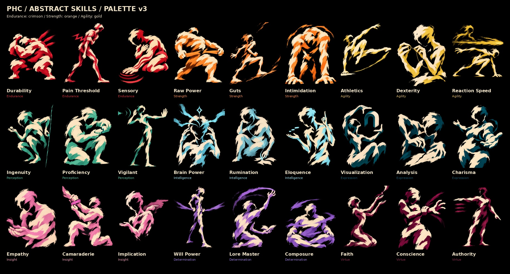
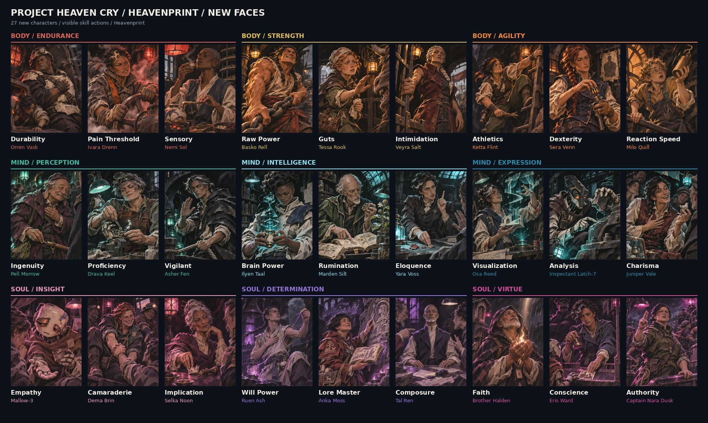

# Project Heaven Cry — art library

Current art assets and implementation handoff: **27 abstract player-skill portraits, 81 character portraits across three versions, the approved Wick trait icon, and Heavenprint/Wick style guide v1.2**. Skill colours use **palette v3**.

## Start implementing

1. Read [Art integration](docs/ART-INTEGRATION.md) for asset selection, import settings and usage examples.
2. Load [art/catalog.json](art/catalog.json) to resolve stable IDs to repository-relative PNG paths, dimensions, colours and checksums.
3. Browse the [labelled asset directory](docs/ASSET-DIRECTORY.md) or the preview sheets below.

## Choose the correct asset family

| Family | Use | Files |
| --- | --- | --- |
| Abstract skills — POC 4 / palette v3 | Player's internal skills and aspects; faceless brush figures | [27 skill PNGs](art/skills/poc4-palette-v3/) |
| Heavenprint New Faces | Characters and NPCs; painted people and automata | [27 character PNGs](art/characters/heavenprint-new-faces/) |
| Wick — Mind Without Fog | Approved trait example; white single-ink mascot | [Transparent PNG and trait text](art/traits/wick/mind-without-fog/) |
| Style guide v1.2 | Future artwork, all nine current skill colours and icon rules | [Start here](art/style-guide/v1.2/START-HERE.md) · [PDF](art/style-guide/v1.2/PHC-Heavenprint-and-Wick-Style-Bible.pdf) |

The character files retain their historical skill filenames for traceability. Use the catalog's **characters** map, keyed by character name, when selecting them. Use its **skills** map for player-skill UI. These two collections are intentionally different.

## Current skill portraits

Endurance is crimson; Strength is orange; Agility is gold. Expression is deep petrol-blue and Virtue is dark mulberry. Every skill uses black background, cream body marks and its attribute colour for all remaining pigment and shadows. See the [palette chart](art/skills/poc4-palette-v3/previews/attribute-palette.png) and [machine-readable palette](art/style-guide/v1.2/palette.json).

## Character portraits

## Validate the handoff

Run `python3 scripts/validate_art.py` from the repository root. It checks the 109 primary images, PNG sizes and colour types, catalog paths, checksums and skill-to-attribute colour mappings. It uses the Python standard library only.

This is an art library, not a game build. No engine import pipeline is assumed. Source PNGs and documentation are unpacked for direct use; there is no duplicate ZIP or Git LFS download step. Older experiments are outside this current production handoff. Reference images inside the guide are intentional style anchors, not additional game-slot assets.

The guide preserves visual decisions; invented character names and imagery do not automatically establish world canon. For future art generation, attach the relevant guide and images rather than relying on the style name alone.

## All three character versions

| Version | Collection | Count |
| --- | --- | --- |
| 1 | [Original Heavenprint](art/characters/original-heavenprint/) | 27 |
| 2 | [First-Patch Revival — latest revision](art/characters/first-patch-revival/) | 27 |
| 3 | [New Faces](art/characters/heavenprint-new-faces/) | 27 |

All 81 originals are preserved. Use `characters[*].collection` to filter the catalog. Earlier collections have namespaced IDs to prevent collisions with New Faces.
