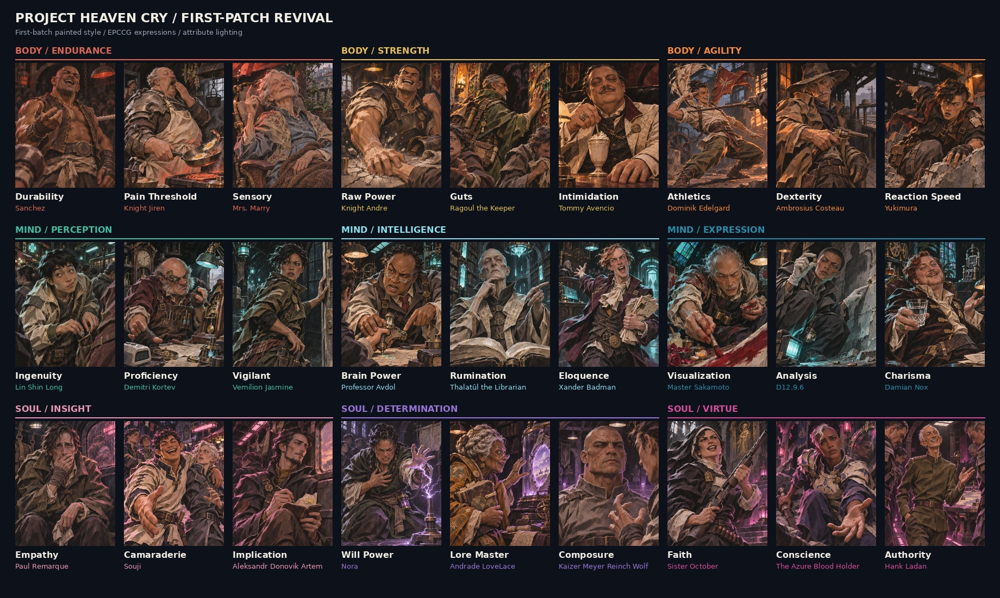

# First-Patch Revival — the EPCCG cast

27 character portraits, 800 × 1000 PNG: the people quoted in the EPCCG skill entries. `manifest.json` maps each file to its character and EPCCG entry; factions are in `docs/lore/EPCCG-Cast-and-Factions.md`../../../portraits/epccg All three character sets were first painted as skill icons; they are now character portraits. See [`../README.md`](../README.md)../../../portraits/epccg

**Revision 3 (5 November 2026):** D12.9.6, Souji, Paul Remarque, Andrade Lovelace and The Azure Blood Holder were redrawn; the catalog now points at [`revisions/`](revisions/README.md)../../../portraits/epccg The originals stay here unchanged.
