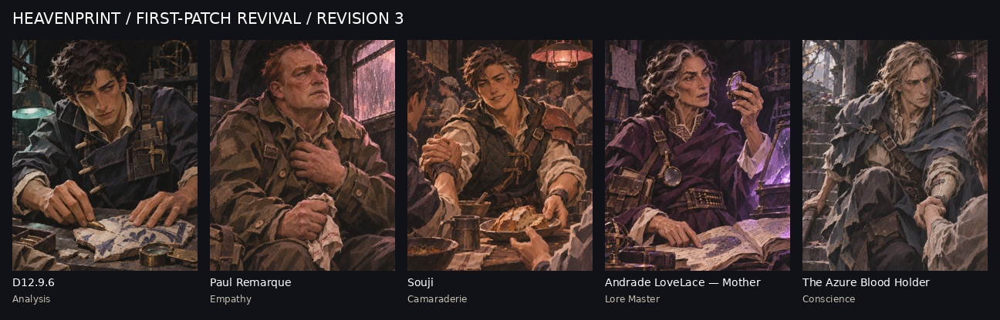

# First-Patch Revival — revision 3 (five portraits)

Delivered 5 November 2026 for [the redo brief](../../../../briefs/first-patch-revival-redo.md); accepted by Leon. These five replace their originals in `art/catalog.json` (the catalog IDs point here now). The originals stay in the parent folders, unchanged, for comparison. The other 22 portraits are untouched.

| Skill | Character | File |
|---|---|---|
| Analysis | D12.9.6 | `../../../../portraits/epccg/analysis.png` |
| Empathy | Paul Remarque | `../../../../portraits/epccg/empathy.png` |
| Camaraderie | Souji | `../../../../portraits/epccg/camaraderie.png` |
| Lore Master | Andrade Lovelace, "Mother" | `../../../../portraits/epccg/lore-master.png` |
| Conscience | The Azure Blood Holder | `../../../../portraits/epccg/conscience.png` |

**Why revision 3 departs from the brief:** revision 2 followed the brief's homage types too literally and came out close to recognisable characters from other works. Revision 3 keeps each person's role and temperament but gives them an original face, hair, silhouette and equipment (the Unspoken Name: homages stay types, never copies). The artist's design notes per portrait are in `manifest-revision-3.json` (`revision_note`).

All 800 × 1000 RGB PNG, Heavenprint.
