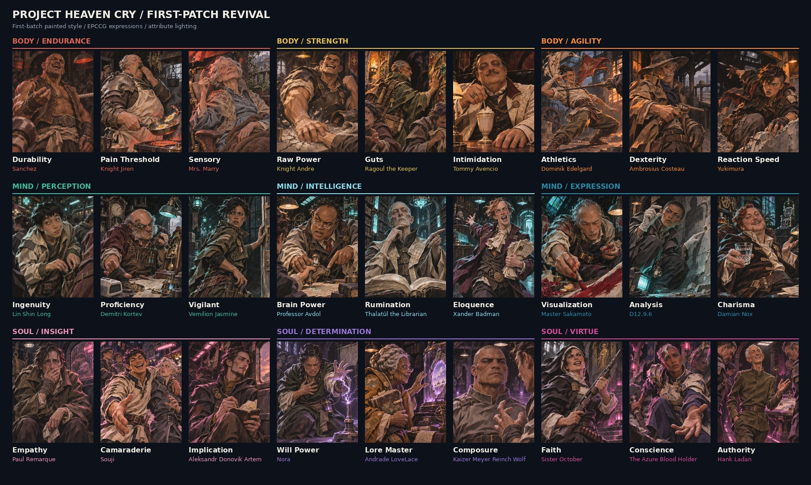

# First-Patch Revival — the EPCCG cast

27 character portraits, 800 × 1000 PNG: the people quoted in the EPCCG skill entries. `manifest.json` maps each file to its character and EPCCG entry; factions are in `docs/lore/EPCCG-Cast-and-Factions.md`. All three character sets were first painted as skill icons; they are now character portraits. See [`../README.md`](../README.md).

