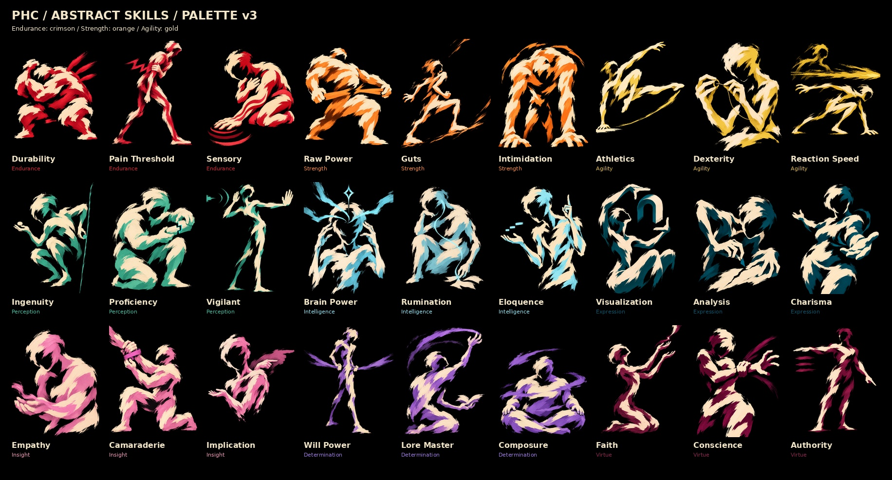

# PHC — Abstract Skills

Version 1.2 • 5 November 2026

# Current art modes / read first

VERSION 1.2 • 5 NOVEMBER 2026

## Character portraits and world illustrations
Use the Original 27 and New Faces sheets for Heavenprint paint, expressive believable faces, restrained stylization, lore equipment and material rendering. The latest New Faces collection is now a CHARACTER asset library. Its old skill labels are archival identifiers, not instructions to put a different person in every player-skill slot.

## Player skill portraits
Use the newest POC 4-derived gestural collection, Palette v3. A skill is an aspect of the player: faceless, incomplete humanoid brush forms with distinct stature and a readable action. Use only black background, cream body marks and the relevant attribute hue. Sections 15–17 define this mode. The user's latest colour changes are included here.

## Wick trait and perk icons
Use the exact approved Mind Without Fog icon. Keep the cape, lantern heart, pixel-screen face and lively asymmetry. Traits use pure white flat ink; requirement-based perk icons use a single mixed requirement colour. This is an independent graphic mode, not a miniature painted skill portrait.

## Reference priority
Current user brief first. Then the reference for the correct art mode. World documents supply facts. This guide supplies visual defaults. Historical labels and palettes on approved character sheets do not override the current skill palette.

This package makes the decisions portable; attach its relevant guide and images in a new chat. A style name alone cannot guarantee identical generation.

# 15 / Abstract skills: gesture before detail

## Body substance is abstract; the action is clear
Use incomplete humanoids built from neutral cream gouache, ragged ink contours and the attribute pigment. Heads have no facial features, eyes, masks or character identity. Hands and joints must still communicate the action. Broken internal masses and lost edges can remove roughly a quarter to a third of the implied body, without severing its readable gesture.

Avoid smooth Unreal-style mannequins, sculpted anatomy, muscle studies and glossy 3D. Also avoid cubist shards, architectural puzzles or ribbons that make the pose unreadable. A bold brush-built body should be understood before its texture is noticed.

## Distinct silhouettes across the set
Vary short and stocky, lanky, broad and heavy, small and wiry, upright, crouched, kneeling, seated, reaching, recoiling and vaulting. Do not repeat the tilted head, narrow torso and chest burst. Each image needs a distinct line of action, weight distribution and hand relationship.

Examples: Durability is a broad protective crouch; Raw Power pulls against resistance; Dexterity is a close, controlled hand action; Empathy receives gently; Conscience restrains its own wrist; Authority orders with a grounded palm. Read the skill meaning before choosing a gesture.

## Composition and finish
One primary humanoid gesture and at most one necessary symbolic cue. Pure black negative space, generous separation around decisive hands, no scenery, costume or competing NPC. Borrow Heavenprint's opaque gouache, broken ink and selective print texture. Do not copy Disco Elysium's exact symbols, compositions or facial constructions.

Final delivery: full-bleed 4:5 RGB PNG, 800 × 1000, no text, frame or UI. Check at 80 px width and beside adjacent skills. If the action disappears, simplify before adding detail.

# 16 / Current skill palette — v3

## Three ingredients only
Background: pure black #000000. Figure body: neutral cream #F2E5C8. Every other coloured mark, shadow and effect: the assigned attribute hue, with lighter or darker values of that same hue. Cream supplies neutral highlights. Do not introduce default pink skin, pale blue background, purple undershading or character-material colours.

| Core | Attribute | Main pigment | Relationship |
|---|---|---|---|
| Body | Endurance | #CC2435 | Bold crimson |
| Body | Strength | #F68A38 | Hot orange |
| Body | Agility | #E3BF51 | Golden yellow |
| Mind | Perception | #40BAA0 | Sea teal |
| Mind | Intelligence | #8BDEEE | Icy cyan |
| Mind | Expression | #075369 | Deep petrol-blue |
| Soul | Insight | #EB95B7 | Rose pink |
| Soul | Determination | #9875D7 | Violet |
| Soul | Virtue | #86234E | Dark mulberry |

## Latest changes
Endurance is bold crimson, clearly separated from the orange family at a distance. Strength now uses orange; Agility now uses gold. Expression remains deep petrol-blue to distinguish it from icy Intelligence. Virtue remains dark mulberry to distinguish it from rose Insight.

## Restricted value ranges
Endurance: #7A1121 shadows, #CC2435 anchor, #E63B4A brighter pigment. Expression: #033443, #075369, #14758B. Virtue: #4C1230, #86234E, #AC3565. Keep Expression and Virtue dark and saturated; use cream, not pastel blue or pink, for the lightest neutral marks.

These are production direction anchors, not a claim that generated art uses an indexed pixel palette. See palette.json for all attributes and skill mappings. Colour must reinforce a distinct silhouette; it cannot carry identification alone.

# 17 / Current abstract skill reference

The newest POC 4-derived gestural set, Palette v3, is the production reference for player skill portraits. It includes the stronger crimson Endurance and the Strength/Agility colour swap, together with the previous Expression and Virtue corrections.

Read the cream masses as action and the coloured masses as the attribute. Compare each group's three poses, and compare adjacent attributes at thumbnail size. The original human sheets remain character-art references; their earlier colour coding is not the current skill palette.

All 27 individual 800 × 1000 PNGs are in the master pack's 04-POC4-Skill-Portraits folder. The 27 New Faces character PNGs are in 03-Character-Portraits. The exact selected Wick example is in 02-Wick-Trait-Example.

