# Wick — Approved Icon Lock

Version 1.3 • 5 November 2026

# 14 / Approved perk and trait icon lock

USER-APPROVED MASTER • 4 NOVEMBER 2026

Exact reference: references/approved-wick-trait-mind-without-fog.png. This is the FIRST Mind Without Fog render, selected by the user after the later clean redraw. Do not select another attempt because its filename says “clean” or “final.”

## What makes it Wick
Keep the short cape/capelet, visible lantern heart, offset fastenings, uneven contours, substantial mitten hands and asymmetry. The user specifically praised the cape, heart and asymmetry as giving the character life. Preserve expressive pose and slightly imperfect shapes rather than imposing mirror symmetry or geometric polish.

The heart is Wick's lantern-heart chest feature, not a requirement to replace it with a conventional heart glyph. Its cross is the 258th Medical Unit's medical cross: in new icons keep the arms thick and equal so it never reads as a gun sight at 40 px, and keep the capelet large enough to see at that size. Keep the expressive pixel-screen face and chamfered head. Costumes and poses can vary while these anchors remain legible.

## Flat ink rules
Traits and perks: pure white #FFFFFF. No attribute or requirement colour appears in an icon. Use cut-outs and sparse graphic separations for interior form. No painterly tonal modelling, gradients, glow or soft drop shadows. Retain the reference's hand-drawn print character; do not automatically sanitize all irregularity into vector geometry.

The bowl, meditating pose and deflected arrows belong to Mind Without Fog, not every icon. For another trait, change the action and symbols to express its actual effect.

## Scope and fidelity
This lock applies to perk and trait icons; it does not change the two approved portrait collections or the pilot's painted style. Preserve the selected source unchanged. Review future exports on the intended UI background so the face, cape folds and heart read correctly without replacing their design.

