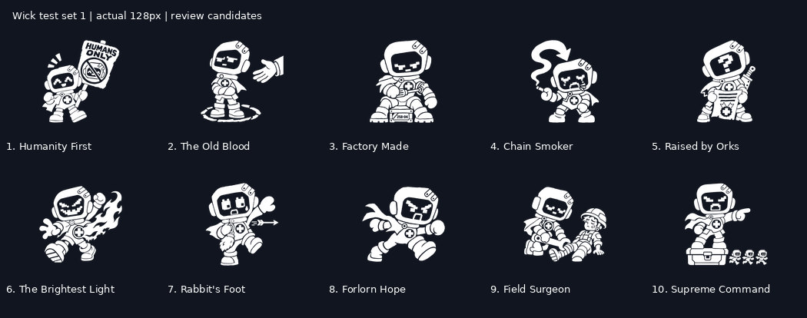
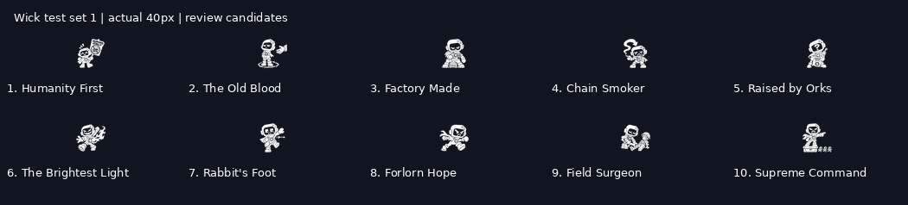

# Wick test set 1

Ten new **review candidates**, generated from the ten actions in [the brief](../../../briefs/wick-test-icons.md) and the approved Mind Without Fog reference. Eight traits and two perks; all use pure white ink. These are not approved production anchors. The 150-icon production run has not started.

Masters are 1024 × 1024 RGBA PNGs with transparent backgrounds and safe margins. `exports/` supplies transparent 256, 128, 64 and 40 px files. Labels appear only on review sheets. The technical export separates the generated ink into pure white RGB and alpha cutouts, pads the complete drawing, and scales it; it does not redraw poses. Original generation files remain in the task's `/workspace/generated_images/` directory. Source hashes and rules-data IDs are recorded in [manifest.json](manifest.json).

| Catalog family | Catalog ID | Rules-data ID |
|---|---|---|
| traits | `humanity-first` | `humanity_first` |
| traits | `the-old-blood` | `the_old_blood` |
| traits | `factory-made` | `factory_made` |
| traits | `chain-smoker` | `chain_smoker` |
| traits | `raised-by-orks` | `raised_by_orks` |
| traits | `the-brightest-light` | `the_brightest_light` |
| traits | `rabbits-foot` | `rabbits_foot` |
| traits | `forlorn-hope` | `forlorn_hope` |
| perks | `field-surgeon` | `field_surgeon` |
| perks | `supreme-command` | `supreme_command` |

## Review notes

The placard, exclusion circle, seated repair, smoke arrow, inverted page, burning cape, near-miss arrow, charge, leg repair and elevated command give the set different silhouettes. Capelets and round medical-cross hearts remain visible at 64 px. The crosses use thick, equal arms. At 40 px the screwdriver, rabbit charm, bandages and tiny commanded figures lose detail; identify the action and silhouette before reading fine marks. A reviewer still needs to perform the brief's name-matching and body-cover tests; these exports are not evidence of a user-approved pass.

The Factory Made candidate reads as self-repair at the arm joint; its shoulder reattachment could be more explicit. The Brightest Light and Forlorn Hope both use running poses; check that the flame versus exposed charge remains enough distinction at the intended UI size. These are the first items to revisit if the review fails.

The [light/dark comparison](previews/light-dark-64px.png) preserves white ink on both surfaces. On light screens, place the unchanged white icon on a dark UI chip. Do not tint it or add an outline to manufacture contrast.

After human review, record selections and revisions here and update the icon lock with established production rules. Keep `production_approved: false` until that review happens.

## Review 1 — 5 November 2026

Reviewed by Claude for Leon on the 128 px and 40 px sheets. Leon's reaction: the set works. Wick's screen acting carries it, and the white ink holds on dark panels. Verdicts below; Leon can overrule any of them. What to do next is in [the production brief](../../../briefs/wick-production-icons.md).

| # | Icon | Verdict | What to change |
|---|---|---|---|
| 1 | Humanity First | Revise | Remove the words on the placard. Keep the placard and the crossed-out Wick face: the symbol says it without text. |
| 2 | The Old Blood | Revise | Cut the floating hand; it reads as a separate object. The chalk circle, folded arms and turned back carry the trait. |
| 3 | Factory Made | Revise | Drop the stencilled number on the crate. Make the screwdriver and the loose arm bigger and clearly at the shoulder; at 40 px it merges with The Old Blood and Raised by Orks. |
| 4 | Chain Smoker | **Approved** | The smoke arrow is a silhouette by itself. Model for the set. |
| 5 | Raised by Orks | **Redo** | The "?" face and page don't say "orks". New action in the production brief. |
| 6 | The Brightest Light | **Approved** | Heaviest ink of the set; keep, but treat it as the upper limit for ink weight. |
| 7 | Rabbit's Foot | Revise | The charm vanishes at 40 px. Make it about twice as big, held up near the face. |
| 8 | Forlorn Hope | **Approved** | Reads apart from The Brightest Light at UI size: no flame, open chest. |
| 9 | Field Surgeon (perk) | Revise | Two full figures turn to mush at 40 px. One Wick only; the patient's bandaged leg enters the frame as a partial. |
| 10 | Supreme Command (perk) | Revise | The three commanded figures read as skulls and crossbones (poison, death). Make them three tiny Wick silhouettes running where Wick points. |

**Rules this review adds** (now in the production brief and the icon lock): no lettering or numbers in any icon; one full figure only; the dominant prop at roughly a third of the frame; ink weight between The Old Blood and The Brightest Light; check at the real UI sizes (44, 48 and 56 px on `#10151F`), not only 40 and 128.

Keep `production_approved: false` on all ten until the revised files pass Leon's review.
