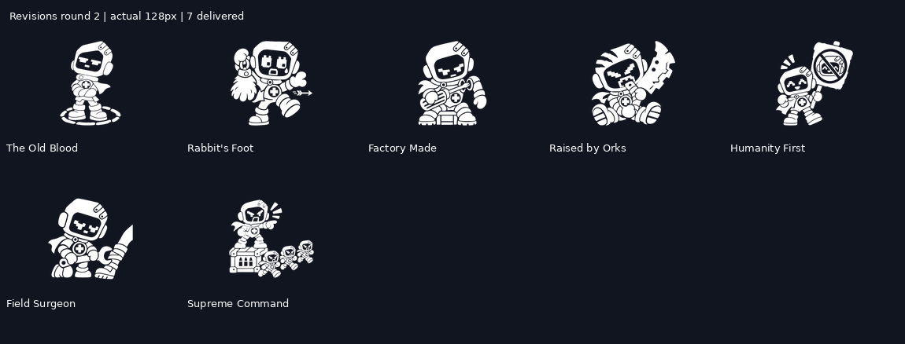
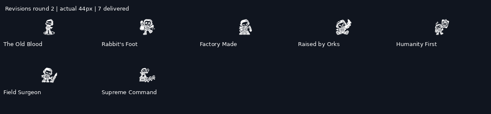

# Wick revisions — round 2

Seven new masters address review 1. First versions remain in the parent directory for comparison. The catalog now resolves these seven IDs to the revised files; the three approved test designs are unchanged.

| Item | Change |
|---|---|
| Humanity First | Symbol-only placard, no lettering. |
| The Old Blood | Floating hand removed; tight chalk circle and closed posture. |
| Factory Made | Unmarked crate, larger screwdriver and visible shoulder socket. |
| Raised by Orks | New toddler pose with war-paint cutouts and an oversized notched cleaver. |
| Rabbit's Foot | Large charm raised beside the face. |
| Field Surgeon | One Wick; only the patient's bandaged lower leg enters the frame. |
| Supreme Command | Three larger whole Wick runners with clear torsos, capes and running boots. |

Masters are 1024 × 1024 pure-white RGBA PNGs, with 256, 128, 64, 56, 48, 44 and 40 px exports. Review sheets also show 40, 48 and 56 px, plus a light/dark comparison. Each keeps `production_approved: false` pending review. Generation source hashes and actions are in [manifest.json](manifest.json).

Leon explicitly requested these fixes be pushed first, followed by the remaining new icons pushed and shown one at a time. Batch names still group review sheets; they no longer pause delivery. The original style and item requirements remain in force.

## Review 2 — 5 November 2026

Reviewed by Claude for Leon on the 128 px and actual 44 px sheets. Leon can overrule any verdict.

| Item | Verdict | Note |
|---|---|---|
| The Old Blood | Pass | The chalk circle and folded arms read at 44 px. |
| Humanity First | Pass | Symbol-only placard works with no words. |
| Rabbit's Foot | Pass | The charm now carries it; the arrow can stay small. |
| Raised by Orks | Pass | The strongest of the round: the toddler pose, war paint and oversized cleaver read instantly. Heaviest ink of the set; treat it as the new upper limit, don't go heavier. |
| Supreme Command | Pass | The runners read as Wick's squad, not skulls. At 44 px they merge into a group, which still reads as "leading". |
| Factory Made | Small fix | At 44 px it reads as "seated robot". Leave a visible gap between the loose arm and the shoulder socket so the reattachment shows. |
| Field Surgeon | Revise | The bandaged leg stands upright beside Wick and reads as a sword (a knife at 44 px). Lay the leg horizontally across the bottom of the frame with the boot clearly drawn, Wick kneeling over it with the wrench. |

Keep `production_approved: false` until Leon signs off. New icons can continue in parallel, as agreed.
